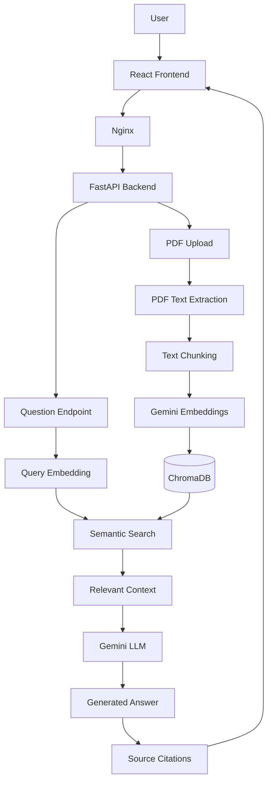

# Multi-Document AI Q&A Assistant

An AI-powered document question-answering system that allows users to upload multiple PDF documents and ask natural-language questions about their contents.

The application uses Retrieval-Augmented Generation (RAG), Google Gemini and ChromaDB to retrieve relevant information and generate context-grounded answers with source citations.

## 1. Key Features

- Upload and process multiple PDF documents.
- Extract text from PDFs using PyPDF.
- Split documents into smaller overlapping chunks.
- Generate vector embeddings using Gemini.
- Store embeddings and metadata in ChromaDB.
- Perform semantic search across uploaded documents.
- Ask questions using natural language.
- Generate context-grounded answers using Gemini.
- Display source document names and page numbers.
- Search across all documents or select a specific document.
- Maintain chat history during the browser session.
- Validate PDF uploads and restrict file sizes.
- Apply API rate limiting.
- Persistent local document and vector storage.
- Dockerized backend and frontend.
- Production frontend served using Nginx.
- Automated backend and RAG tests.

## 2. Technology Stack

| Component | Technology |
|---|---|
| Frontend | React |
| Frontend tooling | Vite |
| HTTP communication | Axios |
| Production frontend server | Nginx |
| Backend | Python, FastAPI |
| LLM | Google Gemini |
| Embedding model | Gemini Embedding |
| Vector database | ChromaDB |
| PDF processing | PyPDF |
| Environment variables | python-dotenv |
| API validation | Pydantic |
| Rate limiting | SlowAPI |
| Containerization | Docker |
| Container orchestration | Docker Compose |
| Testing | Pytest, HTTPX |

## 3. System Architecture



## 4. How the Application Works

### A. Document Ingestion

1. The user uploads a PDF through the React frontend.
2. FastAPI validates the uploaded file.
3. PyPDF extracts text from the document.
4. Extracted text is divided into smaller overlapping chunks.
5. Gemini converts each chunk into a numerical embedding.
6. ChromaDB stores the chunks, embeddings and metadata.

### B. Question Answering

1. The user enters a natural-language question.
2. Gemini converts the question into an embedding.
3. ChromaDB performs semantic similarity search.
4. The most relevant document chunks are retrieved.
5. Retrieved chunks are provided to Gemini as context.
6. Gemini generates an answer using the retrieved context.
7. The frontend displays the answer and source citations.

### C. Retrieval-Augmented Generation (RAG)

RAG combines information retrieval with language generation.

Instead of relying only on the LLM's pretrained knowledge, the application retrieves relevant information from uploaded documents before generating an answer.

This helps ground answers in the provided documents and allows users to receive source references for generated responses.

## 5. Project Structure

```text
hcl-hackathon-qa/
│
├── backend/
│   ├── documents/             # Uploaded PDFs (runtime data)
│   ├── chroma_db/             # ChromaDB storage (runtime data)
│   ├── main.py                # FastAPI application
│   ├── ingest.py              # PDF extraction and chunking
│   ├── document_processor.py  # Embedding and indexing
│   ├── rag.py                 # Retrieval and answer generation
│   ├── requirements.txt       # Python dependencies
│   ├── Dockerfile
│   ├── .dockerignore
│   ├── .env                   # Local secrets (not committed)
│   ├── .env.example           # Environment variable template
│   ├── test_main.py
│   ├── test_rag.py
│   └── other utility scripts
│
├── frontend/
│   ├── public/
│   ├── src/
│   │   ├── App.jsx
│   │   ├── App.css
│   │   └── main.jsx
│   ├── package.json
│   ├── package-lock.json
│   ├── Dockerfile
│   └── .dockerignore
│
├── docker-compose.yml
├── .gitignore
└── README.md
```

Note: Virtual environments, installed Node.js packages, uploaded documents, ChromaDB data and environment files are local runtime files and are excluded from Git.

## 6. API Endpoints

| Method | Endpoint | Description |
|---|---|---|
| GET | `/` | Check API status |
| GET | `/health` | Check application and database health |
| POST | `/upload` | Upload and process a PDF |
| POST | `/ask` | Ask questions about documents |
| GET | `/documents` | Retrieve uploaded document list |

### Upload PDF

`POST /upload`

Accepts a PDF file using multipart form data.

Current upload restrictions:
- PDF files only.
- Maximum file size: 10 MB.
- PDF signature validation.
- Sanitized filenames and UUID-based storage names.

### Ask Question

`POST /ask`

Example request:

```json
{
  "question": "Explain the YOLO architecture",
  "filename": null
}
```

Setting `filename` to `null` searches across all uploaded documents.

### List Documents

`GET /documents`

Returns uploaded document names and their chunk counts.

### Health Check

`GET /health`

Returns the API status, database connection status and number of stored chunks.

## 7. Local Setup

### Prerequisites

- Python 3.11+
- Node.js and npm
- Google AI Studio API key

### Backend Setup

Navigate to the backend directory:

```bash
cd backend
```

Create a virtual environment:

```bash
python -m venv venv
```

Activate it on Windows:

```powershell
.\venv\Scripts\Activate.ps1
```

Install dependencies:

```bash
python -m pip install -r requirements.txt
```

Create a `.env` file:

```env
GEMINI_API_KEY=your_api_key
GEMINI_MODEL=gemini-3.5-flash
EMBEDDING_MODEL=gemini-embedding-2
```

Start the backend:

```bash
uvicorn main:app --reload
```

Backend URL:

http://127.0.0.1:8000

API documentation:

http://127.0.0.1:8000/docs

### Frontend Setup

Open another terminal:

```bash
cd frontend
```

Install dependencies:

```bash
npm install
```

Start the frontend development server:

```bash
npm run dev
```

Frontend URL:

http://localhost:5173

## 8. Docker Setup

The project includes Dockerfiles for both the backend and frontend, along with Docker Compose to run the complete application.

The backend runs using FastAPI and Uvicorn.

The frontend uses a multi-stage Docker build:
1. Node.js builds the React application.
2. Nginx serves the production frontend.

### Prerequisites

- Docker Desktop
- Docker Compose

### Build and Start

From the project root:

```bash
docker compose up -d --build
```

### Access the Application

| Service | URL |
|---|---|
| Frontend | http://localhost:5173 |
| Backend | http://localhost:8000 |
| API documentation | http://localhost:8000/docs |
| Health check | http://localhost:8000/health |

### Check Running Containers

```bash
docker compose ps
```

### View Logs

```bash
docker compose logs -f
```

### Stop Containers

```bash
docker compose down
```

### Persistent Storage

Docker Compose mounts the following local directories:

- `backend/chroma_db` — stores vector database data.
- `backend/documents` — stores uploaded PDF files.

This allows these files to persist when containers are stopped or recreated.

## 9. Environment Configuration

The application uses environment variables to manage API credentials and deployment configuration.

### Backend Environment Variables

| Variable | Description |
|---|---|
| `GEMINI_API_KEY` | Google Gemini API key |
| `GEMINI_MODEL` | Gemini generation model |
| `EMBEDDING_MODEL` | Gemini embedding model |
| `FRONTEND_ORIGINS` | Comma-separated allowed frontend origins |

Example backend `.env`:

```env
GEMINI_API_KEY=your_api_key
GEMINI_MODEL=gemini-3.5-flash
EMBEDDING_MODEL=gemini-embedding-2
FRONTEND_ORIGINS=http://localhost:5173,http://127.0.0.1:5173
```

### Frontend Environment Variables

| Variable | Description |
|---|---|
| `VITE_API_URL` | Backend API base URL |

The Docker frontend build uses the following default:

```text
http://127.0.0.1:8000
```

For deployment, this value should be replaced with the publicly accessible backend URL.

### Environment File Template

A `.env.example` file is provided as a template for configuring the backend.

Never commit actual API keys or `.env` files to GitHub.

## 10. Testing

The project uses Pytest and HTTPX for automated backend testing.

Run all backend tests from the backend directory:

```bash
python -m pytest -v
```

Current test coverage includes:

- API availability.
- Document listing.
- Empty question validation.
- Question length validation.
- Filename validation.
- Invalid PDF uploads.
- RAG answer generation.
- RAG pipeline behaviour.
- Retry behaviour for temporary Gemini failures.
- Source retrieval.

RAG tests use mocked Gemini and ChromaDB responses where applicable.

## 11. Security Measures

The current implementation includes:

- PDF extension and signature validation.
- 10 MB upload size limit.
- Sanitized uploaded filenames.
- UUID-based stored filenames.
- Question length validation.
- Basic IP-based rate limiting.
- Configurable CORS origins.
- Environment variables for API credentials.
- Generic error responses for unexpected failures.
- Docker build exclusions for secrets and unnecessary files.

Additional production security work is required, including:

- User authentication and authorization.
- User-level document isolation.
- Stronger upload validation.
- Production-grade rate limiting.
- Secure deployment of environment variables.
- HTTPS configuration.

## 12. Current Limitations

- Scanned PDFs requiring OCR are not supported.
- Chat history is maintained only in frontend memory.
- Document storage is currently local.
- The application uses a shared ChromaDB collection.
- Gemini API quotas can affect ingestion and question answering.
- Production authentication and multi-user isolation are not yet implemented.
- Retrieval currently uses a fixed top-k value.
- The application has not yet been configured for production cloud storage.

## 13. Future Improvements

- Deploy the application on Microsoft Azure.
- Add authentication and authorization.
- Introduce user-specific document collections.
- Add OCR for scanned PDFs.
- Implement persistent conversation history.
- Add document deletion functionality.
- Improve retrieval using hybrid search and reranking.
- Add monitoring and structured logging.
- Implement more comprehensive integration tests.
- Introduce scalable persistent storage.

## 14. Project Objective

The objective is to build a reliable and scalable document intelligence system that enables users to interact with multiple documents through natural language.

By combining vector search and large language models, the system reduces the need to manually search through lengthy documents and provides context-grounded answers with traceable sources.