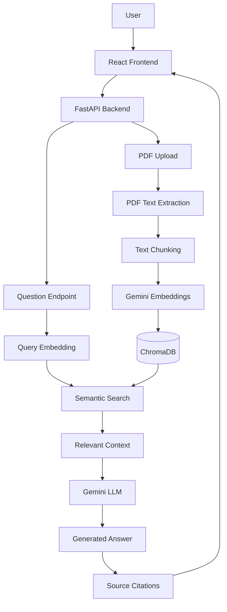

# Multi-Document AI Q&A Assistant

An AI-powered document question-answering system that allows users to upload multiple PDF documents and ask natural-language questions about their contents.

The application uses Retrieval-Augmented Generation (RAG), Gemini and ChromaDB to retrieve relevant information and generate context-grounded answers with source citations.

## 1. Key Features

- Upload and process multiple PDF documents.
- Extract text from PDFs.
- Split documents into smaller overlapping chunks.
- Generate vector embeddings using Gemini.
- Store embeddings in ChromaDB.
- Perform semantic search across uploaded documents.
- Ask questions using natural language.
- Generate answers using Gemini.
- Display source document names and page numbers.
- Search across all documents or select a specific document.
- Maintain chat history during the browser session.
- Validate uploads and restrict file sizes.
- Apply API rate limiting.
- Automated backend and RAG tests.

## 2. Technology Stack

| Component | Technology |
|---|---|
| Frontend | React |
| Frontend development server | Vite |
| HTTP communication | Axios |
| Backend | Python, FastAPI |
| LLM | Google Gemini |
| Embedding model | Gemini Embedding |
| Vector database | ChromaDB |
| PDF processing | PyPDF |
| Environment variables | python-dotenv |
| API validation | Pydantic |
| Rate limiting | SlowAPI |
| Testing | Pytest, HTTPX |

## 3. System Architecture



## 4. How the Application Works

### A. Document Ingestion

1. The user uploads a PDF through the React frontend.
2. FastAPI validates the uploaded file.
3. PyPDF extracts text from the document.
4. Extracted text is divided into smaller overlapping chunks.
5. Gemini converts each chunk into a numerical embedding.
6. ChromaDB stores the chunks, embeddings and metadata.

### B. Question Answering

1. The user enters a natural-language question.
2. Gemini converts the question into an embedding.
3. ChromaDB performs semantic similarity search.
4. The most relevant document chunks are retrieved.
5. Retrieved chunks are provided to Gemini as context.
6. Gemini generates an answer using the retrieved context.
7. The frontend displays the answer and source citations.

### C. Retrieval-Augmented Generation

RAG combines information retrieval with language generation.

Instead of relying only on the LLM's pretrained knowledge, the application retrieves relevant information from uploaded documents before generating an answer.

This helps ground answers in the provided documents.

## 5. Project Structure

```text
hcl-hackathon-qa/
│
├── backend/
│   ├── documents/
│   ├── chroma_db/
│   ├── venv/
│   ├── main.py
│   ├── ingest.py
│   ├── document_processor.py
│   ├── embed_and_store.py
│   ├── search.py
│   ├── rag.py
│   ├── test_main.py
│   ├── test_rag.py
│   ├── requirements.txt
│   └── .env
│
├── frontend/
│   ├── src/
│   │   ├── App.jsx
│   │   ├── App.css
│   │   └── main.jsx
│   ├── package.json
│   └── index.html
│
├── .gitignore
└── README.md
```

## 6. API Endpoints

| Method | Endpoint | Description |
|---|---|---|
| GET | `/` | Check API status |
| POST | `/upload` | Upload and process a PDF |
| POST | `/ask` | Ask questions about documents |
| GET | `/documents` | Retrieve uploaded document list |

### Upload PDF

`POST /upload`

Accepts a PDF file using multipart form data.

### Ask Question

`POST /ask`

Example request:

```json
{
  "question": "Explain the YOLO architecture",
  "filename": null
}
```

Setting filename to null searches across all uploaded documents.

### List Documents

`GET /documents`

Returns the uploaded document names and their chunk counts.

## 7. Local Setup

### Prerequisites

- Python 3.11+
- Node.js and npm
- Google AI Studio API key

### Backend Setup

Navigate to the backend directory:

```bash
cd backend
```

Create a virtual environment:

```bash
python -m venv venv
```

Activate it on Windows:

```powershell
.\venv\Scripts\Activate.ps1
```

Install dependencies:

```bash
python -m pip install -r requirements.txt
```

Create a `.env` file:

```env
GEMINI_API_KEY=your_api_key
GEMINI_MODEL=gemini-3.5-flash
EMBEDDING_MODEL=gemini-embedding-2
```

Start the backend:

```bash
uvicorn main:app --reload
```

Backend URL:

http://127.0.0.1:8000

API documentation:

http://127.0.0.1:8000/docs

### Frontend Setup

Open another terminal:

```bash
cd frontend
```

Install dependencies:

```bash
npm install
```

Start the frontend:

```bash
npm run dev
```

Frontend URL:

http://localhost:5173

## 8. Testing

The project uses Pytest for automated testing.

Run all backend tests:

```bash
python -m pytest -v
```

Current test coverage includes:

- API availability.
- Document listing.
- Empty question validation.
- Question length validation.
- Filename validation.
- Invalid PDF uploads.
- RAG answer generation.
- RAG pipeline behaviour.
- Retry behaviour for temporary Gemini failures.
- Source retrieval.

RAG tests use mocked Gemini and ChromaDB responses.

## 9. Security Measures

Current implementation includes:

- PDF extension and signature validation.
- 10 MB upload size limit.
- Sanitized uploaded filenames.
- UUID-based stored filenames.
- Question length validation.
- Basic IP-based rate limiting.
- Restricted local CORS origins.
- Environment variables for API credentials.
- Generic error responses for unexpected failures.

Additional production security work is required, including authentication, user-level document isolation, stronger upload validation and production rate limiting.

## 10. Current Limitations

- Scanned PDFs requiring OCR are not supported.
- Chat history is maintained only in frontend memory.
- Document storage is currently local.
- The application uses a shared ChromaDB collection.
- Gemini API quotas can affect ingestion and question answering.
- Production authentication and multi-user isolation are not yet implemented.
- Retrieval currently uses a fixed top-k value.

## 11. Future Improvements

- Deploy the application on Microsoft Azure.
- Add authentication and authorization.
- Introduce user-specific document collections.
- Add OCR for scanned PDFs.
- Implement persistent conversation history.
- Add document deletion functionality.
- Improve retrieval using hybrid search and reranking.
- Add monitoring, logging and health checks.
- Implement more comprehensive integration tests.

## 12. Project Objective

The objective is to build a reliable and scalable document intelligence system that enables users to interact with multiple documents through natural language.

By combining vector search and large language models, the system reduces the need to manually search through lengthy documents and provides context-grounded answers with traceable sources.
