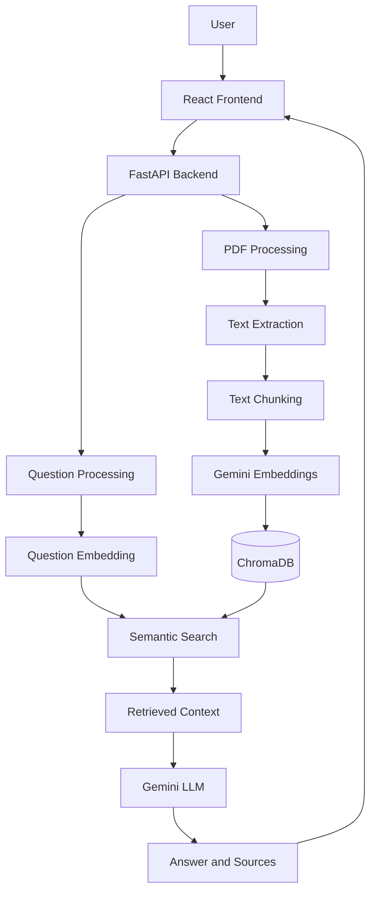
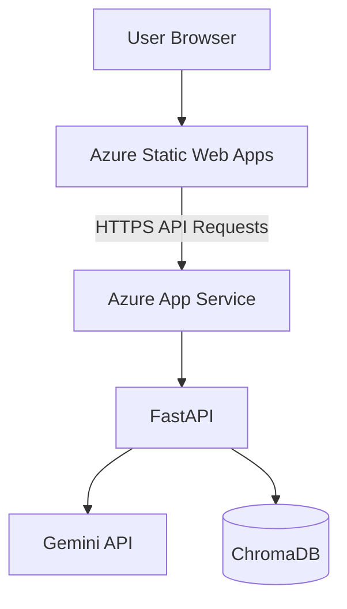

# Solution Design – AI-Powered PDF Question Answering System

## 1. Problem Statement

Users often need to extract specific information from lengthy PDF documents. Manually searching through documents is time-consuming and makes it difficult to locate relevant information quickly.

The objective is to build an AI-powered document question-answering system that allows users to upload PDF documents and ask natural-language questions. The system retrieves relevant information from the uploaded documents and generates context-aware answers using a Large Language Model (LLM).

## 2. Objectives

- Allow users to upload PDF documents.
- Extract and process text from uploaded PDFs.
- Convert document chunks into vector embeddings.
- Store embeddings in a vector database.
- Retrieve relevant document sections using semantic search.
- Generate answers using Gemini based on retrieved context.
- Display answers with source document names and page numbers.
- Provide a simple web interface for document interaction.

## 3. Functional Requirements

1. **PDF Upload:** Users can upload PDF files through the web interface.
2. **Document Processing:** Extract text from PDFs and divide it into smaller chunks.
3. **Embedding Generation:** Generate vector embeddings for document chunks using Gemini.
4. **Vector Storage:** Store embeddings and associated metadata in ChromaDB.
5. **Semantic Search:** Retrieve the most relevant document chunks based on user questions.
6. **Answer Generation:** Generate answers using Gemini based on retrieved context.
7. **Source Attribution:** Display source document names and page numbers.
8. **Document Management:** Display uploaded documents and their indexed chunk counts.

## 4. Non-Functional Requirements

- **Performance:** Retrieve relevant document chunks efficiently.
- **Reliability:** Handle invalid uploads and transient AI API failures.
- **Security:** Validate uploaded files, limit file sizes and protect API credentials.
- **Scalability:** Keep frontend and backend independently deployable.
- **Usability:** Provide a simple interface for uploading documents and asking questions.

## 5. Technology Stack

| Component | Technology | Purpose |
|---|---|---|
| Frontend | React 19, Vite | User interface |
| Backend | Python, FastAPI | REST API |
| LLM | Google Gemini | Answer generation |
| Embeddings | Gemini Embedding API | Vector generation |
| Vector Database | ChromaDB | Embedding storage and retrieval |
| PDF Processing | PyPDF | Text extraction |
| HTTP Client | Axios | Frontend-backend communication |
| Deployment | Azure | Cloud hosting |
| Frontend Hosting | Azure Static Web Apps | Host React application |
| Backend Hosting | Azure App Service | Host FastAPI application |
| CI/CD | GitHub Actions | Automated deployment |

## 6. System Architecture

The application follows a client-server architecture with a Retrieval-Augmented Generation (RAG) pipeline.



### Architecture Components

**1. Frontend**

React provides the user interface for:
- Uploading PDF documents.
- Viewing indexed documents.
- Selecting documents.
- Submitting questions.
- Viewing generated answers and citations.

**2. Backend**

FastAPI handles:
- API requests and validation.
- PDF upload and processing.
- Embedding generation.
- Vector database operations.
- Retrieval and answer generation.

**3. Vector Database**

ChromaDB stores:
- Document chunk text.
- Vector embeddings.
- Source document filenames.
- Original PDF page numbers.

**4. LLM**

Gemini is responsible for:
- Generating embeddings.
- Producing natural-language answers from retrieved context.

## 7. Data Flow

### A. Document Ingestion

1. User uploads a PDF through the React interface.
2. The frontend sends the file to the FastAPI `/upload` endpoint.
3. The backend validates the file extension, PDF signature and maximum file size.
4. PyPDF extracts text page by page.
5. Extracted text is divided into approximately 1,000-character chunks with 150-character overlap.
6. Each chunk is converted into a 768-dimensional embedding using Gemini.
7. Embeddings, text and metadata are stored in ChromaDB.
8. The frontend receives the upload result.

### B. Question Answering

1. User submits a natural-language question.
2. React sends the question to the `/ask` endpoint.
3. FastAPI validates the request.
4. Gemini converts the question into a vector embedding.
5. ChromaDB performs semantic similarity search.
6. The top three relevant chunks are retrieved.
7. Chunks with cosine distance greater than 0.65 are discarded.
8. The remaining chunks are formatted into a context.
9. Gemini receives the question and retrieved context.
10. Gemini generates an answer grounded in the provided context.
11. The backend returns the answer and source citations.
12. React displays the answer and document page references.

If no sufficiently relevant context is found, the system returns a predefined response instead of generating an unsupported answer.

## 8. API Design

| Endpoint | Method | Description |
|---|---|---|
| `/` | GET | Basic API information |
| `/health` | GET | API and ChromaDB health status |
| `/upload` | POST | Upload and process PDF |
| `/ask` | POST | Ask questions about documents |
| `/documents` | GET | List indexed documents |

### Example Question Request

```json
{
  "question": "What is the architecture of YOLO?",
  "filename": "YOLO_CVPR2016.pdf"
}
```

### Example Response

```json
{
  "question": "What is the architecture of YOLO?",
  "filename": "YOLO_CVPR2016.pdf",
  "answer": "YOLO uses a single neural network to predict bounding boxes and class probabilities directly from an image.",
  "sources": [
    {
      "filename": "YOLO_CVPR2016.pdf",
      "page": 3
    }
  ]
}
```

## 9. Database Design

ChromaDB uses a persistent collection named `documents` with cosine distance.

Each stored record contains:

| Field | Description |
|---|---|
| ID | Unique chunk identifier |
| Document | Extracted text chunk |
| Embedding | 768-dimensional vector |
| Source | Stored PDF filename |
| Page | Original PDF page number |

The source filename and page number allow the application to associate retrieved content with its original location.

## 10. Security and Error Handling

The application implements the following safeguards:

- Restricts uploads to PDF files.
- Validates PDF file signatures.
- Limits uploaded files to 10 MB.
- Sanitizes uploaded filenames and adds UUID prefixes.
- Validates question length and request parameters.
- Applies rate limiting of 10 question requests per minute per IP.
- Configures CORS to allow the deployed frontend origin.
- Stores Gemini credentials in environment variables.
- Retries transient Gemini generation errors (429, 500 and 503).
- Returns a fallback response when relevant context cannot be retrieved.

## 11. Deployment Architecture

The application is deployed as two independent services.



**Frontend**
- Hosted using Azure Static Web Apps.
- Built using Vite.
- Automatically deployed through GitHub Actions.

**Backend**
- Hosted using Azure App Service.
- Runs FastAPI using Uvicorn.
- Uses environment variables for configuration.
- Stores ChromaDB data in persistent application storage where configured.

**CI/CD**
- GitHub Actions automates frontend and backend deployments when changes are pushed to the main branch.

## 12. Design Decisions and Trade-offs

| Decision | Reason | Trade-off |
|---|---|---|
| React + FastAPI | Simple separation of frontend and backend | Requires API integration and CORS configuration |
| ChromaDB | Easy integration with embedding-based retrieval | Less suitable for large distributed workloads |
| Gemini | Provides embedding and generation capabilities | Depends on external API availability and quota |
| Chunking with overlap | Preserves context across chunk boundaries | Increases storage and embedding costs |
| Top-3 retrieval | Limits the amount of context sent to Gemini | May miss relevant information |
| Cosine distance threshold | Filters weakly relevant results | Requires tuning for different document types |
| Separate Azure services | Independent frontend and backend deployment | Requires separate deployment configuration |

## 13. Limitations

- Only PDF documents are supported.
- Scanned PDFs requiring OCR are not supported.
- Embedding generation can be slow for large documents.
- Retrieval uses fixed top-k and distance threshold values.
- Uploaded documents share a common ChromaDB collection.
- There is no authentication or multi-user isolation.
- Chat history is stored only in frontend memory.
- The application depends on Gemini API availability and quota.
- The current F1 hosting tier has limited compute capacity.

## 14. Future Enhancements

- Add OCR support for scanned documents.
- Introduce authentication and user-specific document access.
- Support DOCX and TXT formats.
- Implement asynchronous document processing.
- Improve retrieval using reranking and hybrid search.
- Add persistent conversation history.
- Introduce document deletion and management.
- Add automated integration testing.
- Improve monitoring and error reporting.

## 15. Conclusion

The solution demonstrates an end-to-end Retrieval-Augmented Generation application that combines React, FastAPI, Gemini and ChromaDB.

It allows users to upload documents, retrieve relevant information through semantic search and receive context-grounded answers with source citations.

The architecture separates the presentation, API and retrieval layers, making the application easier to maintain, extend and deploy.